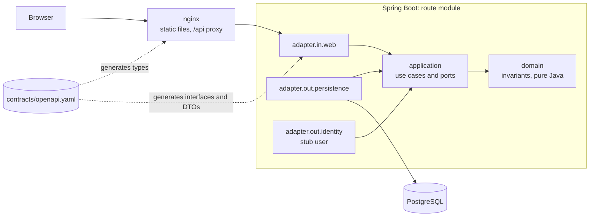
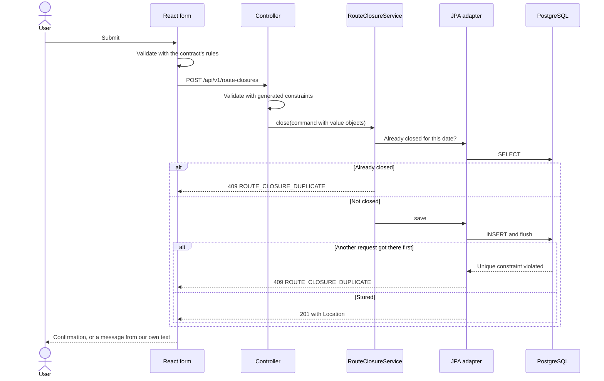

# Wolfandfox

[](https://github.com/Franjaresc/Wolfandfox/actions/workflows/ci.yml)
[](LICENSE)

A back-office for courier and last-mile logistics. Dispatchers record the end-of-day result of each delivery route, and every closure stays consistent, even when two people close the same route at once.

**Why it exists:** it's a portfolio project that shows how I design software, using a small domain and taking the engineering seriously: clear boundaries, a contract both sides are built from, and rules enforced by tests rather than by convention. **All data is fictional.**

**Stack:** Java 21 · Spring Boot 4 · PostgreSQL 16 · Flyway · React 19 · TypeScript · OpenAPI · Testcontainers · Docker · GitHub Actions

<!--
Screenshots: add these files, then remove this comment's markers around the images.
  docs/images/closure-form.png    the form, with a validation error showing
  docs/images/closure-list.png    the list, with several closures
  docs/images/closure-detail.png  one closure


-->

## Run it

Only Docker is needed:

```sh
cd deploy
docker compose up --build
```

Open <http://localhost:8081>. To stop, press Ctrl+C. `docker compose down -v` also deletes the data.

> **Status:** the container build is verified by the CI job, and its first run is pending.

All host ports are bound to loopback. To change them, copy `deploy/.env.example` to `deploy/.env` and edit it.

| Service | Default address |
|---|---|
| Frontend | <http://localhost:8081> |
| Backend API | <http://localhost:8080/api/v1/route-closures> |
| PostgreSQL | `localhost:15432` |

## Architecture

A modular monolith, in one repository, with one hexagonal module per bounded context. Dependencies point inward, so business rules know nothing about Spring, JPA or HTTP.



### What happens when a route is closed



## Business rules

The domain enforces these invariants. The contract, the form and the database repeat them where they can, as a first line of defence.

- **Codes:** route, vehicle and driver codes are 2 to 20 uppercase letters, digits or hyphens, starting with a letter or digit.
- **Counts:** packages delivered, failed and returned, and kilometres driven, are whole numbers, 0 or more.
- **Total:** total packages is derived from the three counts and never stored.
- **Notes:** optional, up to 1000 characters.
- **One per day:** a route can be closed only once per date, even when two requests arrive at the same moment.
- **No future dates:** the closure date is today or earlier. "Today" comes from the server's clock, in the zone set by `WOLFANDFOX_TIME_ZONE` (default UTC). See [ADR-0008](docs/adr/0008-business-dates-and-time-zones.md).
- **Set by the server:** who closed the route and when.

## Key decisions

Each has a record with its trade-offs and the alternatives rejected.

| Decision | Why | Record |
|---|---|---|
| Modular monolith in a monorepo | One context has nothing to split, and boundaries stay cheap to change. | [ADR-0001](docs/adr/0001-monorepo-and-modular-monolith.md) |
| Hexagonal, enforced by ArchUnit | Rules outlive frameworks, and a boundary violation fails the build. | [ADR-0002](docs/adr/0002-hexagonal-architecture-enforced-by-tests.md) |
| Contract-first API | Both sides are generated from one file, so drift stops compiling. | [ADR-0003](docs/adr/0003-contract-first-api-with-generated-code.md) |
| Spring Boot 4 | A new project shouldn't start with a migration already owed. | [ADR-0004](docs/adr/0004-spring-boot-4.md) |
| Strict JSON, stable error codes | Bad input is rejected instead of guessed at. Real responses are checked against the contract in tests. | [ADR-0005](docs/adr/0005-strict-api-behaviour-and-contract-tests.md) |
| Committed frontend types, no UI framework | The build fails on stale types. Three simple views don't justify a framework. | [ADR-0006](docs/adr/0006-frontend-stack-and-generated-types.md) |
| Containers and CI | Designed for a one-command run, with a CI job that tests the images too. | [ADR-0007](docs/adr/0007-containers-and-ci.md) |
| Business dates from an injected clock | "No future dates" needs a deterministic, configurable "today". | [ADR-0008](docs/adr/0008-business-dates-and-time-zones.md) |

## Testing strategy

| Layer | Tools | What it proves |
|---|---|---|
| Domain and use cases | JUnit 5, Mockito, AssertJ | Invariants and business rules, with no framework or database |
| Web | MockMvc | Status codes, validation and problem+json shape. No internal details leak. |
| Contract | openapi-request-validator | Actual responses match `openapi.yaml`, on every API test |
| Persistence and end to end | Testcontainers, PostgreSQL 16 | Real SQL, migrations and constraints, and the whole application over HTTP |
| Concurrency | Testcontainers | Two simultaneous requests end in exactly one 201 and one 409. A barrier forces the race on every run. |
| Architecture | ArchUnit | Dependency direction, and that JPA entities and repositories stay where they belong |
| Frontend | Vitest, Testing Library, MSW | Validation, error handling and states, as a user sees them, with the network mocked at the HTTP boundary |
| Full stack | `deploy/smoke-test.sh` in CI | Built to prove that the images work together over HTTP. Pending its first CI run. |

## Develop locally

Needs Docker, JDK 21 and Node 26 (see `frontend/.nvmrc`).

```sh
# 1. Database only
cd deploy
cp .env.example .env
docker compose up -d postgres

# 2. Backend on port 8080. On Windows, use .\mvnw.cmd instead of ./mvnw
cd backend
./mvnw spring-boot:run

# 3. Frontend on http://localhost:5173, forwarding /api to the backend
cd frontend
npm ci
npm run dev
```

The full stack also uses port 8080 by default, so stop it first with `docker compose down`, or change `BACKEND_PORT`. If the backend runs on another port in this mode, copy `frontend/.env.example` to `frontend/.env` and change it there.

<details>
<summary>Commands</summary>

**Backend**, in `backend/`:

| Command | What it does |
|---|---|
| `./mvnw test` | Unit, web and architecture tests. No Docker needed. |
| `./mvnw verify` | Also the integration tests. Docker must be running. |

**Frontend**, in `frontend/`:

| Command | What it does |
|---|---|
| `npm run dev` | Dev server with the `/api` proxy |
| `npm run build` | Checks the generated types, type-checks and builds |
| `npm test` | Runs the tests once |
| `npm run lint` | ESLint, allowing no warnings |
| `npm run typecheck` | TypeScript compiler |
| `npm run format` | Formats with Prettier. `format:check` only reports. |
| `npm run types:generate` | Regenerates the types after a contract change |
| `npm run types:check` | Fails if the types are out of date with the contract |

</details>

## Development approach

Implemented with Claude Code under my direction: I defined the requirements and design, and reviewed and approved every decision. `CLAUDE.md` holds the conventions the assistant follows, and the decision records show the reasoning and trade-offs, which I can explain and defend.

## Limitations and roadmap

This is a portfolio project and not production software:

- **No authentication yet.** Every closure is recorded as a fixed fictional user, behind a port that is ready for a real one.
- **The default database password is a public placeholder.** The setup is for local use only, with no HTTPS and no deployment.
- **One use case.** A closure can't be edited or reopened, and vehicles and drivers are plain codes.
- **No browser tests.** Tests run in jsdom, which doesn't do layout, so rendering, phone layouts and keyboard use have no automated coverage. A manual check in a real browser is still pending.
- **The container images are not yet confirmed to build.** See the note under [Run it](#run-it).
- **Some tools are held back.** ESLint 9 is no longer supported upstream, because the accessibility plugin doesn't accept ESLint 10 yet. See [ADR-0006](docs/adr/0006-frontend-stack-and-generated-types.md).

Next on the [roadmap](docs/backlog.md): authentication and security hardening, English and Spanish translations, Kafka events with a reporting service, file storage for proof of delivery, and observability.

## Documentation

- [Architecture Decision Records](docs/adr/README.md)
- [API contract](contracts/openapi.yaml)
- [Backlog](docs/backlog.md)
- [Conventions for AI assistants](CLAUDE.md)

## License

[MIT](LICENSE)
